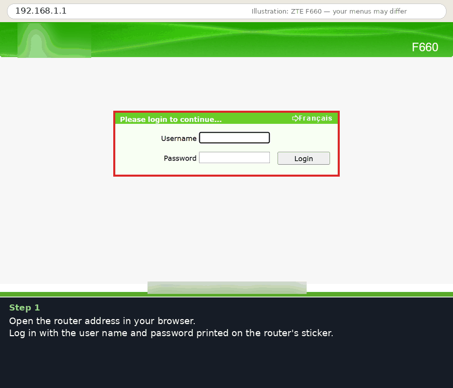

# GuardMesh

A network-level adult-content filter built for **a moment of weakness**.

A browser extension can be switched off with one click. GuardMesh moves the protection out of the browser
and makes turning it off **slow, visible and vetoable**: not impossible (nothing is, against someone who owns the
device), but hard to do on impulse.

It comes in **two versions**. Pick one, or use both.

| | **A. The Box** (full protection) | **B. Router mode** (no extra hardware) |
|---|---|---|
| What it is | A small always-on computer (Raspberry Pi, old PC) running a filter + guardian | A tool that sets a filtering DNS on your router, or on single devices |
| Hardware | One always-on device (≈3 W for a Pi) | None |
| Protects | Every device on your Wi-Fi, by MAC address | Every device on the Wi-Fi (router setting), or one device (script) |
| Per-device rules / trusted devices | Yes | No (router-wide), or per device with scripts |
| Pausing needs a request + waiting period | **Yes** | No: whoever has the router/device password can undo it |
| Partner gets alerts and can cancel from their phone (Telegram) | **Yes** | No |
| Tamper watchdog (switches protection back on) | **Yes** | No |
| Works behind a locked ISP router | Yes (needs only the DHCP switch) | Only if the router lets you change its DNS |
| Setup difficulty | Medium (one install command + a web wizard) | Easy (guided, or one script per device) |
| Best for | Self-control with a partner; parents | Quick start; parents who just want a filter; laptops and phones away from home |

**Rule of thumb:** if the goal is *self-control*, use the Box. If you only need a quick family filter, use Router mode.
In both versions the strongest ingredient is the same: **a partner who holds the password** you must not know.

---

## Protect this computer in one click

No router, no box, no install: download the file for your system and open it. It sets the family filter
(Cloudflare for Families) on **this computer only**, so it stays protected on any Wi-Fi, also away from home.

| Your system | Protect | Remove the protection | How to open it |
|---|---|---|---|
| **Windows** | [Protect this computer](https://github.com/MohamedBen21/guardmesh/releases/latest/download/guardmesh-protect-windows.cmd) | [Remove](https://github.com/MohamedBen21/guardmesh/releases/latest/download/guardmesh-remove-windows.cmd) | Double-click the file |
| **Mac** | [Protect this Mac](https://github.com/MohamedBen21/guardmesh/releases/latest/download/guardmesh-protect-macos.command) | [Remove](https://github.com/MohamedBen21/guardmesh/releases/latest/download/guardmesh-remove-macos.command) | Terminal: `bash ~/Downloads/guardmesh-protect-macos.command` |
| **Linux** | [Protect this computer](https://github.com/MohamedBen21/guardmesh/releases/latest/download/guardmesh-protect-linux.sh) | [Remove](https://github.com/MohamedBen21/guardmesh/releases/latest/download/guardmesh-remove-linux.sh) | Terminal: `bash ~/Downloads/guardmesh-protect-linux.sh` |
| **Android** | One setting: *Private DNS* → `family.cloudflare-dns.com` | Set Private DNS to *Automatic* | Settings → Network & internet |
| **iPhone / iPad** | [Profile](https://github.com/MohamedBen21/guardmesh/releases/latest/download/guardmesh-protect-iphone.mobileconfig) (or use the dashboard of the Box) | Settings → General → VPN, DNS & Device Management → remove | Open the file on the phone, then Settings → *Profile Downloaded* |

> The files are attached to the latest [release](https://github.com/MohamedBen21/guardmesh/releases/latest), so
> the links download directly. You can read every file first in the
> [`downloads/`](https://github.com/MohamedBen21/guardmesh/tree/main/downloads) folder. On an iPhone, a
> download from the web may not offer to install the profile: use AirDrop, or the dashboard of the Box. If you run the
> Box, its dashboard has the same buttons (card **Protect this computer**).

**The warnings you may see are normal.** The files are not signed by a company (that costs money every year), so
operating systems are careful with them:

- **Browser:** "is not commonly downloaded" / "could be harmful" → choose **Keep**.
- **Windows:** a blue "Windows protected your PC" window → **More info → Run anyway**. Then **Yes** on "Do you want
  to allow this app to make changes?" (changing DNS needs administrator rights).
- **Mac:** "cannot be opened because it is from an unidentified developer" → run it from the Terminal as shown above.
- **Linux / Mac:** the command asks for your password (to change the network settings).

**Do not trust a file you cannot read.** Everything here is plain text: open any file in Notepad and read it. The
Windows file runs the PowerShell script embedded in it (it is the same code as `npm run router -- device`, which
writes a readable `.ps1`). It only sets DNS servers; it installs nothing and contacts nobody.

**To undo it**, use the *Remove* link (it sets DNS back to automatic). Anyone using the computer can run it, so this
is friction, not a lock. A real lock needs the Box and a partner.

These files are regenerated with `npm run build:downloads`; the tests fail if they get out of date. To publish new
ones, push a version tag (`git tag v0.4.3 && git push origin v0.4.3`): a GitHub Action attaches them to a release.

---

## What this can and cannot stop

It **raises the bar**; it is not a lock.

- It cannot stop mobile data, other Wi-Fi networks, VPNs, Tor, or a person who resets the router or boots the box
  from another disk. Mitigation: the partner holds the router password; the Box alerts the partner when it goes
  offline or restarts; use the device scripts on laptops and phones that leave the house.
- DNS filtering is domain-based. New or unlisted sites, and adult content inside mainstream platforms, can slip through.
- Browsers with their own "Secure DNS" setting can bypass the router. The Box blocks well-known DNS-over-HTTPS
  servers; in Router mode set the browser's Secure DNS to *off* or to the same provider.

Intended for **consenting adults** (with a partner they chose) and for **parents of minors**. Tell people what is
filtered on their own devices.

---

# A. The Box

```
 phone / laptop / TV ──► Wi-Fi router ──► internet
        │   (the router's DHCP is OFF; the box hands out addresses instead)
        ▼
  ┌──────────────── the box ────────────────┐
  │ AdGuard Home   DNS filter + DHCP         │  sees every device's MAC address
  │ guardian       wizard + watchdog + bot   │  controls AdGuard through its API
  └──────────────────────────────────────────┘
```

**How it protects**

- **Strict by default.** Every device, including brand-new ones and ones with a randomised MAC, is filtered.
  Only devices you mark *trusted* are exempt. Devices are remembered by MAC address.
- **Weakening protection is a request, never a switch.** "Pause protection" and "exempt this device" start only
  after the waiting period (default 24 h). The partner is alerted immediately and can **cancel with one tap in
  Telegram**. Pauses end by themselves. *Restoring* protection is always instant.
- **Partner key.** Created at setup and sent straight to the partner (Telegram/webhook), so the protected person
  never sees it. It lets the partner skip the waiting period or change settings. Only a hash is stored; five wrong
  tries lock the check for 15 minutes.
- **Tamper watchdog (every 30 s).** If protection is found off outside an approved window, or an unapproved
  exemption appears, it is reverted and the partner is told. A reboot or unplug sends "the box restarted".
- **The AdGuard admin password is random** and shown to nobody. AdGuard's own admin page listens only on the box.
- **Blocks DNS-over-HTTPS bypass servers** and the Firefox DoH switch; turns on safe search and parental control.

## What you need

- A **Raspberry Pi** (3B+ or newer, 2 GB RAM is plenty) with a microSD card, **connected to the router with a
  network cable**, always powered. Any always-on Linux PC (Debian/Ubuntu) also works.
- Access to your router's admin page, only to turn its **DHCP server off** once.
- Optional but recommended: a Telegram account for the partner.

> ⚠️ **Important:** with the router's DHCP off, devices get their network settings from the box. **If the box is
> off, those devices have no internet** until you turn the router's DHCP back on. Keep the router admin page and
> password handy (ideally with your partner).

## Install

1. **Prepare the Pi.** Flash *Raspberry Pi OS Lite (64-bit)* with Raspberry Pi Imager, enable SSH in the imager's
   settings, plug it into the router, and log in over SSH. (Any Debian/Ubuntu machine works the same way.)
2. **Give the box a fixed IP.** The easiest way is a *DHCP reservation* for it in the router's admin page.
   Do this **before** turning DHCP off.
3. **Get the code onto the box** and install:
   ```bash
   unzip guardmesh.zip && cd guardmesh   # or: git clone <your repo url>
   sudo ./install.sh
   ```
   `install.sh` installs Docker if needed, frees port 53 if the system uses it, and starts the two containers. When
   it finishes it prints the wizard address, like `http://192.168.1.50:8080`.

## The setup wizard (5 steps)

Open the wizard address from any phone or computer on your Wi-Fi. Pick **English, Français or العربية** at the top.

1. **Who is it for?** Yourself or your family, and the **waiting period** (1 h, 6 h, 24 h, 3 days).
2. **Your accountability partner.** Optionally enter the partner's **Telegram chat ID** and **bot token** (see below).
   With no contact details, the key is shown once on screen: hand the phone to your partner so they write it down.
3. **Partner key.** Sent to the partner (or shown once).
4. **Connect your network.** *Full mode:* turn the router's DHCP **off**, then press the button. *DNS-only mode:*
   if you can't or won't touch DHCP, press "Skip" and set the box's address as the DNS server in the router (or on
   each device): everything that uses it is filtered, but devices are not listed by name.
5. **Trusted devices.** Tick the devices that should *not* be filtered (for example the parents' laptop).

### Telegram setup (2 minutes)

1. In Telegram open **@BotFather**, send `/newbot`, pick a name and a username that ends in `bot`
   (for example `my_guardmeshrd_bot`). BotFather replies with a **token**: keep it secret.
2. **Choose a neutral bot name** (use `/setname`, e.g. "guardmeshrd"). Alerts appear on the lock screen.
3. The **partner** opens the new bot and presses **Start**. A bot cannot message someone who never started it.
4. The partner sends any message to **@userinfobot** to learn their numeric **chat ID**.
5. Enter the chat ID and token in wizard step 2 (or later in *Partner settings*) and press **Send test alert**.

### What the partner can do from Telegram

Every alert about a request carries a **Cancel request** button; alerts about an active pause carry
**Restore protection now**. Two commands also work: `/status` (state and pending changes, each with a button) and
`/restore`. Only the configured chat is obeyed, and every action strengthens protection: a hijacked chat can cancel
or restore, never weaken.

## Daily use

Open `http://<box-ip>:8080`. The dashboard shows protection status, requests (with countdowns), devices, recent
activity, and the box's address.

- **Pause or exempt a device:** press *Request a pause…* / *Request exemption*. It starts after the waiting period.
  The partner can press *Partner approve* with the key to start it sooner.
- **Cancel / restore:** anyone can, instantly (it only strengthens protection).
- **Partner settings** (needs the partner key): waiting period, alert language, Telegram and webhook details,
  *Send test alert*.
- **Alert times** use the box's timezone. Set `TZ` in `docker-compose.yml` (default `Africa/Algiers`).
- **Optional heartbeat:** set `HEARTBEAT_URL` (for example a healthchecks.io ping URL) so the partner is alerted
  when the box stops responding.

## Try it first on Windows or macOS (DNS-only test mode)

Docker Desktop can't do DHCP, so this tests the filter and the guardian logic only.

```
docker compose -f docker-compose.windows.yml up -d --build
```

Open `http://localhost:8080`, run the wizard, **skip step 4** (DNS-only), then:

```
nslookup <an adult domain> 127.0.0.1     (should answer 0.0.0.0)
nslookup wikipedia.org 127.0.0.1         (should resolve normally)
```

Remove everything with `docker compose -f docker-compose.windows.yml down --rmi all -v` and delete the `data` folder.

## Update, stop, uninstall (Linux)

```bash
docker compose up -d --build          # update after pulling new code
docker compose stop                   # pause (keeps settings)
docker compose down --rmi all -v && sudo rm -rf data     # remove everything
```
Then turn the router's DHCP back on. If you disabled systemd-resolved's stub listener, remove
`/etc/systemd/resolved.conf.d/guardmeshrd.conf` and run `sudo systemctl restart systemd-resolved`.

---

# B. Router mode (no extra hardware)

Sets a **family-filter DNS** (Cloudflare for Families, CleanBrowsing, OpenDNS FamilyShield) on your router, or on a
single device, and checks that it really works. Nothing has to stay running: you configure once.

## Install

Install **Node.js 20 or newer** (nodejs.org, the LTS button), then in this folder:

```
npm install
npm run router
```

`npm run router` with no options asks simple questions. Everything can also be done with options (below).
The tool is in English for now.

## 1. All devices on your Wi-Fi: set up the router

```
npm run router -- setup
```

- **Normal / ISP router (default, "manual"):** prints step-by-step instructions for your router's admin page:
  where to find the DNS fields, the exact values to type, IPv6, and the partner-password step.
- **OpenWrt** (`--router openwrt --host 192.168.1.1`): changes the router's DNS over SSH. *Experimental.*
- **MikroTik RouterOS 7** (`--router mikrotik --host 192.168.88.1 --user admin`): changes it through the REST API
  (enable the `www` service first). *Experimental.*
- **Huawei 4G/5G HiLink routers** (`--router huawei-hilink --host 192.168.8.1`): changes the DNS over the router's web
  API. **Untested on real hardware** (see below).
- Add `--dry-run` to see exactly what would be done without changing anything.

### What it looks like (example: ZTE F660)



Most routers are the same idea with different menu names: open the router address, log in with the sticker
password, find the DNS fields (usually under LAN / DHCP), type the two addresses, save, then have your partner change
the admin password. Only the address and the menu names change.

### Not sure what router you have?

```
npm run router -- detect
```

Finds your router's address, looks at its login page (no password is used, nothing is changed) and tells you whether an
automatic recipe exists. `src/router/database.ts` lists known router families and the usual problems (for example, boxes
that lock the DNS field). That list is **leads from public research, not verified**, and holds no passwords.

### No recipe for your router? Brand notes

```
npm run router -- setup --router manual --brand zte-f6xx      # or huawei-ont, nokia, tplink, fritzbox, livebox, xfinity, att
npm run router -- setup --router manual --brand locked        # "my router won't let me change DNS"
```

Prints the generic steps plus where the DNS fields usually are on that brand, login notes and known traps. These notes
are **unverified** (written from general knowledge, not checked on devices; menus change with firmware and ISP) and live in
`src/router/brandGuides.ts`: corrections are welcome. The "locked" page lists what to do when the ISP hides the field
(your own router behind the ISP box, the Box, per-device scripts).

### How automatic recipes stay safe

Every automatic recipe runs through the same runner: it reads the current settings, **saves a backup first**, shows the
before/after, asks for confirmation, applies, then **reads the router back** to confirm the change stuck. Your router
password is used once and never written to disk. Undo with
`npm run router -- undo --router huawei-hilink --host <ip>` (uses the newest backup in `./guardmesh-backups`).
Each recipe carries a status: **verified** (run on a real device), **community** (reported working by users),
**untested** (written from documentation or open-source code only).

Verified so far: manual setup and `verify` on the **ZTE F660**, the **Windows** one-computer script, and the **Box** (with MAC device detection) on a spare PC.

### Adding or testing a router recipe

A recipe is a small driver (`login`, `read`, `dnsOf`, `withDns`, `write`, `logout`; see `src/router/runner.ts`) plus a
mock router in `test/` that replays the protocol. Run `detect` and `setup --dry-run` on your router and report what
happened (model, firmware, the output; never passwords) so it can move from *untested* to *community*/*verified*.

**Lock it.** Ask your **partner** to set a *new* router admin password and keep it. Without this, anyone in the house
can undo the change in a minute. This one step is what turns a filter into accountability.

> Many ISP-supplied routers (for example common ZTE/Huawei boxes) hide or grey out the DNS fields, or hide them
> behind a different admin account. If yours does, use the per-device scripts below, or the Box.

## 2. One device: scripts and profiles

```
npm run router -- device
```

| Device | What you get |
|---|---|
| Windows | `.ps1` apply + undo scripts (run in PowerShell as administrator) |
| Mac | `.sh` apply + undo scripts |
| Linux (NetworkManager) | `.sh` apply + undo scripts |
| Android 9+ | One setting: *Private DNS* → `family.cloudflare-dns.com` (works on mobile data too) |
| iPhone / iPad | A `.mobileconfig` profile (DNS over HTTPS) |

Perfect for the laptop that visits other Wi-Fi networks, or when the router can't be changed. Each device has to be
set once, and a person with admin rights on that device can undo it, so this is friction rather than a lock.

## 3. Check that it works

```
npm run router -- verify
```

It resolves test domains three ways (this computer, the filter directly, an unfiltered resolver) and tells you
**ACTIVE**, **NOT active** or **inconclusive**. Run it after every change, and from time to time afterwards.

## 4. Undo

```
npm run router -- undo
```

## All options

| Option | Meaning |
|---|---|
| `--provider <id>` | `cloudflare-families` (default), `cleanbrowsing-family` (strictest), `cleanbrowsing-adult`, `opendns-familyshield` |
| `--router <type>` | `manual` (default), `openwrt`, `mikrotik` |
| `--host`, `--user`, `--password` | router address and login (MikroTik password can also be `ROUTER_PASSWORD`) |
| `--dry-run`, `--yes`, `--no-verify` | preview only / no confirmation / skip the check |
| `--os <name>`, `--out <folder>` | device command: `windows`, `macos`, `linux`, `android`, `ios`; output folder |
| `--domain a.com,b.com` | domains to test with in `verify` |

Provider addresses are those published by each service at the time of writing; confirm them on the provider's site.

---

# Using both together

Run the **Box** at home for whole-house control with the partner, and use **device scripts** (or Android Private DNS /
iPhone profile) on laptops and phones that leave the house, so the protection travels with them.

# Languages

The wizard, dashboard and partner alerts are available in **English, Français and العربية** (right-to-left).
The French and Arabic texts were written with AI help: **please have a native speaker review them**. They live in
`web/translations.js` (interface) and `src/i18n.ts` (alerts); a test makes sure no language is missing a text.

# Troubleshooting

| Problem | What to do |
|---|---|
| `install.sh` says port 53 is in use | It frees it for systemd-resolved. Otherwise find the program with `sudo ss -lntup | grep :53` |
| Nobody in the house has internet | The box is off or crashed and the router's DHCP is still off: turn DHCP back on in the router |
| Device list is empty | DNS-only mode lists no devices. In full mode, reconnect Wi-Fi on the device and press Refresh |
| `[adguard] ... failed` in the logs | AdGuard's API changed: run `docker compose logs guardian` and open an issue with that line |
| No Telegram alerts | Did the partner press **Start** on the bot? Check token and chat ID, then *Send test alert* |
| `verify` says "NOT active" | Router settings not saved or devices not reconnected; the computer uses its own DNS/VPN/browser Secure DNS |
| `verify` says "inconclusive" | The provider may not block the test domain: try `--domain` with another one |
| Wrong times in alerts | Set `TZ` in `docker-compose.yml` to your timezone |

# Development

```bash
npm install
npm test           # 39 tests: guardian logic, partner API, Telegram bot, i18n, router mode
npm run dev        # run the box service locally (needs an AdGuard Home to talk to)
npm run router     # run the router-mode tool
npm run build      # compile to dist/
```

```
src/                 box service: guardian logic, AdGuard client, Telegram bot, web API, i18n
src/router/          router mode: providers, verify, device scripts, drivers, guided steps, CLI
web/                 wizard + dashboard (plain HTML/JS, no build step) and translations
test/                unit and API tests (no network needed)
docker-compose.yml   Linux box (host networking, DHCP)        docker-compose.windows.yml   DNS-only test mode
```

# Status: what is tested and what is not

**Tested by the author on real hardware (October 2026)**
- **The Box**, running 24/7 on a spare PC: it worked as expected, including **DHCP and device detection by MAC address**.
- **Telegram alerts with the Cancel button** on the real Telegram service: the partner can cancel a pending change from the alert.
- **Android phone** (old device, Private DNS with `family.cloudflare-dns.com`) and **iPhone** (new device): Cloudflare Family DNS filtering worked on both.
- **iPhone**: both setting the DNS by hand and installing the generated `.mobileconfig` profile worked.
- **The one-computer scripts for macOS and Linux**: tested by a friend of the author, who reported they work (no model or version recorded).
- **Telegram commands** `/status`, `/restore` and `/help` on the real Telegram service: all work.
- **The one-click files** `guardmesh-protect-windows.cmd` (self-elevating launcher) and `guardmesh-protect-linux.sh`: both worked on the author's computers.
- **The one-computer script** (`device`, Windows): applied filtering to the PC it was run on and worked.
- **The manual router method on a ZTE F660**, following the guide: an adult site was blocked in the browser, and the `verify` command reported **ACTIVE**. The ZTE F660 guide is marked *verified*.
- Earlier, against a **real AdGuard Home** (Docker on Windows, DNS-only mode): setup, adult blocklists, DoH blocking,
  delayed pause, partner-key approval, wrong-key refusal, instant restore, tamper watchdog, and Telegram alerts.
- The wizard in a real browser in all three languages, including right-to-left Arabic.
- 59 automated tests: delays, approvals, tamper revert, device discovery, partner key and lockout, settings
  validation, Telegram bot (with a simulated Telegram), alert wording and languages, router-mode scripts and logic,
  the Huawei HiLink recipe against a mock router.

**Not tested yet**
- The dashboard card **Protect this computer** on real machines (the download itself works in a real browser; the files it hands out are the ones tested above).
- The OpenWrt and MikroTik drivers on real routers.
- The **Huawei HiLink** recipe on a real router: it passes 15 tests against a mock built from the open-source `huawei-lte-api` client, nothing more.
- Other router brands. The ZTE F660 is the only one confirmed so far; the notes for ZTE (other models), Huawei fiber, Nokia, TP-Link,
  FRITZ!Box and the rest are written from general knowledge and marked *unverified*.

Tried it on your hardware? Tell us the model and what happened (never passwords) so it can be marked *verified*.

# Roadmap

1. Test on a real Pi with a spare router; fix API drift; add integration tests against an AdGuard container.
2. A prebuilt Pi image (nothing to install).
3. nftables rules on the box: block DNS-over-TLS (853), known DoH servers, optionally VPN protocols.
4. More router recipes (ZTE, Huawei ONT, Nokia, TP-Link): need real captured pages or community contributions.
5. Router-mode `verify` on a schedule with a Telegram alert when filtering stops.
6. French and Arabic for the router-mode tool; reviewed translations.
7. Partner web view (read-only log, approve or deny from anywhere).

# License

MIT (see `LICENSE`). Use it to help people, and tell them what it does.

*Disclaimer:* GuardMesh is an independent project. It is not made by, endorsed by or affiliated with
Cloudflare, CleanBrowsing, OpenDNS/Cisco, AdGuard, Telegram, ZTE, Huawei, MikroTik, OpenWrt, TP-Link, Nokia, Apple,
Google, Microsoft or any internet provider. Those names are trademarks of their owners and are used only to say which
service or product something works with. The software is provided as is, without warranty.
